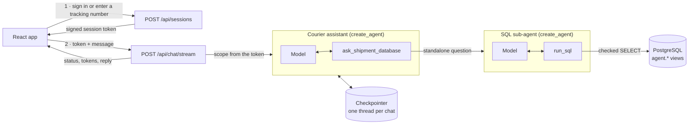

# 🚚 CourierTrack

**CourierTrack** is an AI courier assistant. Customers and parcel recipients ask about shipments in
plain language and get answers from live data. It's built with **LangChain 1.x agents**,
**FastAPI**, **PostgreSQL** and **React**.

---

## 🎯 Use case

- **Customers** sign in and ask about everything they've sent: recent shipments, statuses,
  delivery dates, scan history, saved addresses and account details.
- **Recipients** enter a tracking number, with no account, and chat about that one package:
  *"When will it arrive?"*, *"Where is it right now?"*
- General shipping questions are answered directly.

Replies stream in as they're written, and a conversation survives a page reload or a server
restart.

---

## 🎥 Demo

https://github.com/user-attachments/assets/cc70025f-3886-46a0-a679-091f95172ac8

*The video shows the first version of the app.*

---

## ⚙️ How it works



1. The browser starts a **session**: a customer signs in, or a recipient enters a tracking number
   that the server checks exists. The server signs who the chat is for into a session token.
2. Each message goes to the **courier assistant**, a LangChain `create_agent` agent. It answers
   general questions itself and calls `ask_shipment_database` for anything that needs data.
3. That tool hands a standalone question to the **SQL sub-agent**, another `create_agent` agent.
   It writes PostgreSQL, runs it with `run_sql` (up to four tries, reading its own errors), and
   reports the facts back.
4. Replies stream to the browser as server-sent events. A status line shows while the database
   lookup runs.
5. A LangGraph **Postgres checkpointer** keeps one thread per chat. `SummarizationMiddleware`
   condenses older turns once a thread passes a token threshold.

## 🔐 Security model

LLM-written SQL is only safe if the model can't decide whose data it reads, so the scope is
enforced in layers:

1. **The server decides the scope.** The customer id or tracking number comes from a signed
   token and reaches tools through LangChain's `ToolRuntime` context. The model never sees it
   and can't change it.
2. **The SQL is checked** (`backend/app/sql_guard.py`). The checker accepts one `SELECT` over
   four views, an allowlist of functions and a row cap. It rejects `set_config`, `pg_sleep`,
   `query_to_xml`, writes, DDL and catalog access.
3. **The database enforces the boundary anyway** (`db/sandbox.sql`). Queries run as
   `courier_agent`, a read-only role that can only read `agent.*` views. Those views show only
   the rows of the scope the app bound to that connection's backend process. The role can't read
   base tables, the scope table or password hashes, and `set_config` can't change the scope.
   Each query runs as a prepared statement in a read-only transaction with a 5-second timeout.
4. **Logins.** Passwords are Argon2 hashes. Login tokens and chat tokens are signed with
   separate salts, and CORS only allows the frontend's origin.

Known limits: there's no rate limiting, and tokens can't be revoked before they expire. Treat
this as a demo, not a production-ready system.

---

## 🛠 Tech stack

- **Agents:** LangChain 1.4 (`create_agent`, middleware, `ToolRuntime`), LangGraph 1.2 with
  `langgraph-checkpoint-postgres`, Groq (`openai/gpt-oss-20b` by default)
- **Backend:** FastAPI, psycopg 3 (async pools), sqlglot, itsdangerous, Argon2
- **Frontend:** React 19, Vite, Tailwind CSS, React Router, react-markdown
- **Database:** PostgreSQL (users, addresses, shipments, tracking updates)

---

## 🚀 Getting started

You need Python 3.11+, Node.js 20+, PostgreSQL 14+ and a [Groq API key](https://console.groq.com/keys).

### 1. Database and backend

```bash
createdb -U postgres courier_db          # skip if the database already exists

cd backend
python -m venv .venv
.venv\Scripts\activate                   # macOS/Linux: source .venv/bin/activate
pip install -r requirements-dev.txt
cp .env.example .env                     # then fill it in (see Configuration)
python scripts/setup_db.py
```

`setup_db.py` is safe to run again. On an empty database it loads `db/schema.sql` and
`db/seed.sql`. Every time, it creates the `courier_agent` and `courier_app` roles from the URLs
in `.env`, applies the sandbox, login and checkpoint schemas, and gives each demo customer the
`DEMO_PASSWORD`.

### 2. Run the API

```bash
python -m app            # http://127.0.0.1:8000, interactive docs at /docs
python -m app --reload   # restart on code changes
```

`python -m app` uses a selector event loop, which psycopg's async mode needs on Windows. If you
run uvicorn yourself, use
`uvicorn app.main:create_app --factory --loop asyncio:SelectorEventLoop`.

### 3. Run the frontend

```bash
cd frontend
npm install
npm run dev              # http://localhost:5173
```

---

## 💡 Try it

- **Anonymous Tracking:** `TN4255-8215-9617` (in transit, Tunis to Lyon), `FR5657-1034-8818`
  (out for delivery) or `TN7295-5795-1821` (delivered).
- **Customer Service:** sign in as `habib_bencheikhali` (or `marie_dupont`, `carlos_garcia`, …)
  with the `DEMO_PASSWORD` from `backend/.env`.

Example questions:

- *"Show me my recent shipments"*
- *"Which of my packages are still in transit?"*
- *"When will it arrive?"*
- *"How many shipments have I sent to France?"*
- *"How long does international shipping usually take?"*

The demo data dates from August–September 2025, so the assistant reports undelivered packages as
late. To shift every date so the newest shipment is two days old, run
`psql -U postgres -d courier_db -f db/refresh_demo_dates.sql`.

---

## 🧪 Tests

```bash
cd backend
pytest                       # 102 tests; database tests skip if Postgres isn't prepared
python scripts/eval.py       # sample conversations against the real model, with the SQL it ran
ruff check . && ruff format --check .

cd ../frontend
npm run lint && npm run build
```

The database tests send SQL straight to the sandbox, skipping the checker, to show that
PostgreSQL itself blocks other customers' rows, base tables, writes and `set_config` tricks.

---

## 🔧 Configuration

All settings live in `backend/.env`. See `backend/.env.example` for the full list.

| Variable | Purpose |
| --- | --- |
| `GROQ_API_KEY` | Your Groq key |
| `MODEL`, `SQL_MODEL` | Any `init_chat_model` id; `SQL_MODEL` defaults to `MODEL` |
| `ADMIN_DATABASE_URL` | Superuser URL, used only by `setup_db.py` |
| `AGENT_DATABASE_URL` | The read-only sandbox role that runs LLM-written SQL |
| `APP_DATABASE_URL` | The app role: binds scopes, checks logins, stores checkpoints |
| `DEMO_PASSWORD` | Password `setup_db.py` gives the demo customers |
| `SESSION_SECRET` | Signs login and chat tokens (32+ characters) |
| `CHECKPOINTER` | `postgres` (chats survive restarts) or `memory` |
| `SUMMARY_TRIGGER_TOKENS`, `SUMMARY_KEEP_MESSAGES` | When to summarize, and how many recent messages to keep |
| `CORS_ORIGINS` | JSON list of allowed frontend origins |

The frontend reads `VITE_API_URL` (default `http://localhost:8000`).

---

## 📁 Project layout

```
backend/
  app/
    agent/        assistant (supervisor), SQL sub-agent, prompts, context
    api.py        HTTP routes
    database.py   sandbox and app connection pools
    sql_guard.py  checks LLM-written SQL
    security.py   tokens and password hashing
  scripts/        setup_db.py, eval.py
  tests/
db/               schema, seed data, sandbox, logins, checkpoints
frontend/         React app
```
